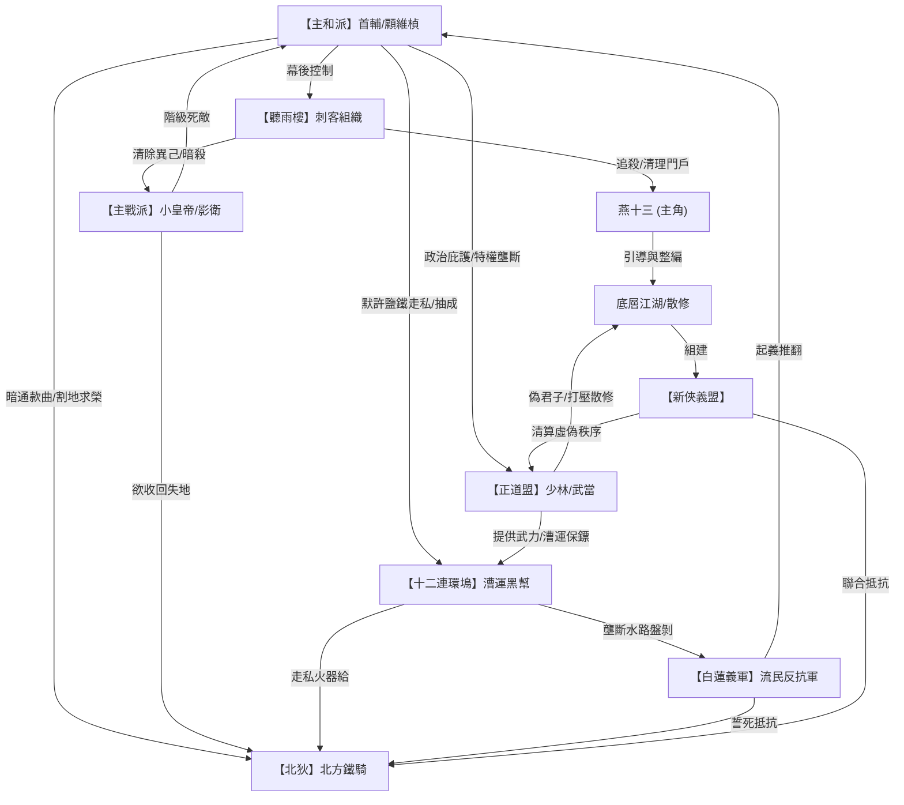

# 《聽雨風雲錄》人物關係網絡

本文件定義《聽雨風雲錄》中核心角色與各大陣營之間的利益、情感及敵對關係。

## 1. 核心人物關係表

| 角色 A | 關係類型 | 關係描述 |
| :--- | :--- | :--- |
| **燕十三** ⚔️ **阿阮** | **生死相許 / 智勇雙璧** | 燕十三是阿阮的「護身之刃」，在一次次生死遭遇戰中護其周全；阿阮是燕十三的「心靈港灣」與「天道啟蒙者」，用智慧引導他從殺人工具覺醒為守護萬民的俠者。 |
| **燕十三** ⚔️ **顧維楨** | **宿敵 / 叛離與抹殺** | 燕十三原為顧維楨（聽雨樓主）手中的底層棋子。江南夜戰決裂後，燕十三成為顧維楨必欲除之的隱患；燕十三則在流亡中認清其賣國面目，誓要斬殺此賊。 |
| **阿阮** ⚔️ **顧維楨** | **血海深仇** | 顧維楨為了防止通敵陰謀敗露，下令聽雨樓暗殺阿阮之父齊衡。阿阮身負父親留下的兵部機密，誓要揭發顧維楨，報仇雪恨。 |
| **顧維楨** ⚔️ **小皇帝** | **權臣軟禁 / 篡位威脅** | 小皇帝視顧維楨為架空皇權的國賊，欲除之而後快；顧維楨視小皇帝為過渡的傀儡，暗中密謀弒君稱帝。 |
| **小皇帝** ⚔️ **沈寒石** | **絕對忠誠 / 君臣信任** | 沈寒石是小皇帝在深宮中唯一信任的「影子」，其統領的影衛是保皇派最後的武力。 |
| **燕十三** ⚔️ **沈寒石** | **亦敵亦友 -> 廟堂與江湖的盟友** | 起初沈寒石奉命追查兵部侍郎遇刺案，與燕十三生死相搏；後雙方發現顧維楨的賣國證據，達成聯盟。第12章沈寒石在聽雨軒廢墟中私放燕十三並轉交齊太師玉珮。第24章夜宴之變中，沈寒石施展「無回劍」以命相博攔下姬無情，掩護燕十三和阿阮突圍，生死未卜。第四卷少室山大會中沈寒石重傷落敗，大會平定後代表天子宣賞燕十三與阿阮，被婉拒後，手拄木杖默默目送二人退隱江南。第五卷兵變後，沈寒石重傷隨隊奔襲京城，在午門前率殘部做先鋒決死衝鋒，被軟劍刺穿胸膛時，燃燒周身氣血以無回劍意斬斷絞車盤龍鐵鏈，門閂震碎宮門大開。沈寒石拄劍傲立溘逝，英烈殉國。 |
| **燕十三** ⚔️ **林鐵衣** | **俠義相惜 / 戰場戰友** | 燕十三在北方孤城雪夜決戰中，以驚天一刀救下義軍與邊防士卒，贏得林鐵衣的敬重。後期兩人在反抗首輔兵變時裡應外合。 |
| **燕十三** ⚔️ **莫孤雁** | **虛假收留 / 拔刀梟首** | 莫孤雁（鐵劍門掌門）假意款留高燒的燕十三，暗中下毒欲將其捕殺以向黑道邀功。被燕十三識破後，在鐵劍門正殿將其當眾梟首。 |
| **燕十三** ⚔️ **祖鐵衣** | **死敵 / 獵殺與突圍** | 祖鐵衣（怒濤堂主）把持運河碼頭，是十二連環塢在江南追捕燕十三與阿阮的主力。 |
| **阿阮** ⚔️ **關勝** | **女諸葛 / 豪俠相惜** | 關勝（義軍隊長）在山寨中被阿阮用九章算術平息糧餉暴動的智慧折服，尊稱其為「女諸葛」，並在第一卷末期暗中配合影衛協助燕十三北上。 |
| **燕十三** ⚔️ **三金牌刺客** | **叛徒清理 / 逐一擊破（已反殺）** | 雨絲、雨霧、雨狂奉首輔之命前來清算燕十三。燕十三利用三人的心理破綻，在聽雨軒設局分割並將其全數擊殺（第9-11章）。 |
| **燕十三** ⚔️ **乾帝** | **君臣暗盟 / 忘年之交** | 第16章燕十三在沈寒石指引下夜探冷宮，被年僅14歲但隱忍擔當的傀儡皇帝劉湛打動，兩人以刀血立誓達成救國之暗盟，成為皇帝唯一的殿外底牌。 |
| **阿阮** ⚔️ **齊太師** | **叔侄晚輩 / 信物傳遞** | 齊太師為齊衡的族叔。他在被軟禁期間將刻有解密密鑰定數的墨玉如意交予燕十三帶給阿阮，促成第二卷證據方位的解開。第五卷兵變後被投入天牢，第53章被燕十三斬鎖救出，臨終吐露顧維楨枯榮手致命命門（左肋期門穴生枯交替遲滯）後，在阿阮懷中溘逝。 |
| **燕十三** ⚔️ **雷震天** | **招攬與利用 -> 宿敵決戰** | 高手大會上，雷震天看重「無名」重劍神力，在第15章在后棚親自賞銀並給予夜宴名帖以進行招攬，燕十三假扮市井粗人虛與委蛇。後期夜宴之變中，兩人生死相搏，雷震天在粉塵大爆炸中被燕十三以短刀刺喉身亡。 |
| **燕十三** ⚔️ **姬無情** | **宿敵追獵 / 鏡像博弈** | 姬無情是聽雨樓第一金牌刺客。在高手大會上他冷眼看破「無名」發力步法具備鐵牌特徵。第24章夜宴火海中，兩人生死決鬥，燕十三在中毒與重傷下不敵姬無情，被沈寒石以命相救逃脫。兩人的最終決戰將在第五卷紫禁之巔展開。 |
| **燕十三** ⚔️ **林鐵衣** | **俠義導師 / 生死相惜** | 林鐵衣以天下局勢與百姓生路引導燕十三的思想覺醒。第26章火爐夜話，林鐵衣以大義啟迪燕十三「為萬民而揮才是萬民之盾」，燕十三於雪夜向林鐵衣三叩首拜謝，兩人結為忘年之交，並在北方平州、寒水城並肩守禦抗狄。 |
| **燕十三** ⚔️ **陸乾雄** | **叛國死敵 / 冰封之斬** | 陸乾雄（鎮江王）為割據稱王而賣國引兵入關。第27章燕十三潛入王府竊聽其撤防屠城陰謀；第28章陸乾雄私撤精銳導致平州城破大亂，燕十三在混亂中帶流民突圍並發誓取其首級，最終將在平州平定王府將其梟首。 |
| **燕十三** ⚔️ **陸大石** | **生死袍澤 / 鐵血兄弟** | 陸大石是守城校尉。燕十三敬重其寧死不降的骨氣，兩人聯手死守寒水城，結下深厚的戰場袍澤之情。 |
| **燕十三** ⚔️ **赤兀台** | **奇襲斬首 / 敵膽俱裂** | 赤兀台（北狄前鋒）率軍圍攻孤城。燕十三利用雁門暗道奇襲敵營，萬軍之中將其割喉梟首，化解孤城危局。 |
| **燕十三** ⚔️ **空照禪師** | **舊法清算 / 少室決死（已斬首）** | 空照禪師（少林方丈）為維護高利貸黑金特權而設局伏魔。燕十三在大會上拼死一搏，以左肩碎裂為代價近身施展瞬息斬，挑斷其雙臂經脈與手筋廢其武功，並當眾將其梟首伏誅。 |
| **燕十三** ⚔️ **沖虛道人** | **權謀博弈 / 伏地認罪** | 沖虛道人（武當掌門）精於權謀、霸佔鐵礦，在對決中認輸以保全性命。空照禪師伏誅後被反綁跪地認罪，當眾交出武當黑金分贓與霸佔的鐵礦契約。 |
| **燕十三** ⚔️ **阿吉** | **俠義傳承 / 新任盟主** | 阿吉是底層散修，大捷後燕十三拒絕朝廷神王封號，將「聽雨」短刀親自託付給阿吉作為新俠義盟盟主信物，並告誡其警惕腐敗，將大任傳承於他。 |
| **燕十三** ⚔️ **封不二** | **教官死敵 / 竹林反殺** | 封不二（副樓主）易容在中原製造滅門案栽贓燕十三。燕十三在竹林中識破其易容與暗器破綻，將其強行擊殺。 |
| **燕十三** ⚔️ **祖四海** | **利益死敵 / 船桅對決** | 祖四海（黑道盟主）為首輔死守京城水防。燕十三強攻其戰船，在旗艦「翻江號」的高空橫桅上對決，受潮汐震盪重心失衡，被燕十三以剛猛重刀「瞬息斬」梟首，屍身墜入大江身亡，水路防線徹底打破。 |
| **阿阮** ⚔️ **兀魯** | **火藥伏擊 / 戰略宿敵** | 兀魯（北狄統帥）率重裝騎兵「鐵鷂子」進攻。阿阮在城樓精算時間與拋物線，發射神火飛鴉火器重創其主力，將其擊退。 |
| **燕十三** ⚔️ **顧維楨（枯榮極限）** | **終局生死決戰 / 聽雨一刀** | 顧維楨以針刺死穴激發潛能，爆發出野獸般怪力與極速，雙手淬有枯榮散劇毒。燕十三在暴雨中冷靜應對，利用顧維楨體溫過高導致雨水蒸發的白色蒸汽軌跡，在雨幕中一刀刺穿其左肋下的命門要害將其梟首。 |

---

## 2. 陣營利益糾葛圖 (利益鏈條)

---

## 3. 江湖與廟堂的勾結細節

1. **鹽鐵走私利益鏈**：
   - 顧維楨利用首輔職權，放寬江南鹽鐵管制的批文。
   - 十二連環塢利用漕運和海路，將這些管制鹽鐵大量運往北方，直接銷售給北狄（用於打造鐵騎裝備與後勤儲備），獲取暴利。
   - 正道盟在陸路上以「行俠仗義、護送鏢銀」為名，充當走私隊伍的保護傘，地方官府因首輔的關係不敢查驗。
   - 三方將暴利按比例分贓，顧維楨用這筆錢賄賂朝廷將領、收買人心，為篡位鋪路。

2. **江湖大洗牌的爆發點**：
   - 當燕十三挑翻正道盟數個百年名門時，不僅是武學上的勝利，更是直接斬斷了顧維楨的黑金來源。
   - 正道盟高層的醜聞（如少林暗中放高利貸逼死農民、武當勾結藩鎮霸佔礦山）被公開後，底層江湖人不再信任舊秩序，紛紛加入燕十三的「新俠義盟」，完成了江湖權力向底層的轉移。
